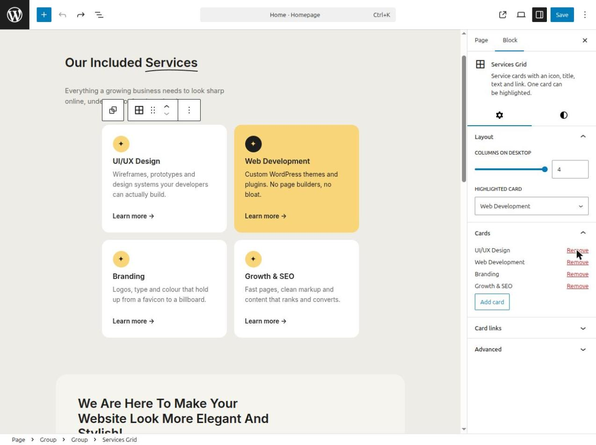
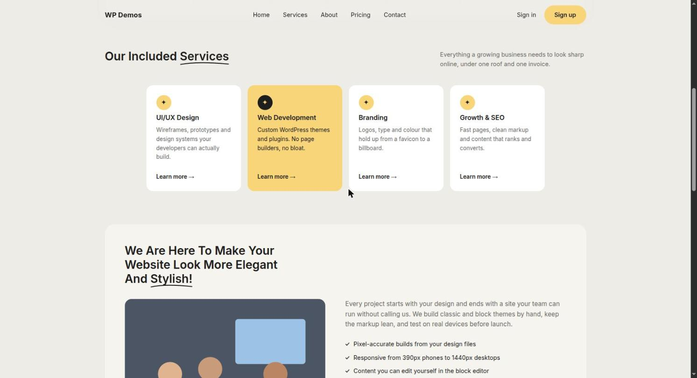
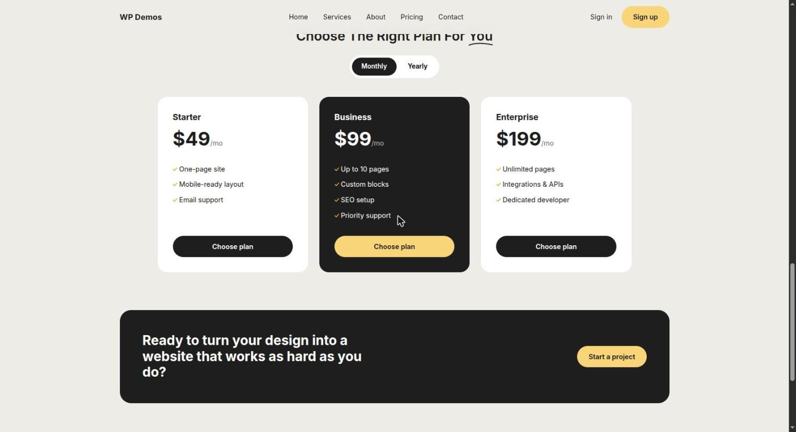

# WP Demos: custom Gutenberg blocks on a hand-built theme

A WordPress landing page built without a page builder. The layout is a classic PHP theme; the
content sections are **custom dynamic Gutenberg blocks** that a client can edit in the block
editor: change text in place, add or remove cards and plans, pick the highlighted item, set
prices and links.


## What it shows

| Area | Where |
|---|---|
| Three dynamic blocks: Services Grid, Pricing Table, Stats Bar | `plugins/demo-blocks/src/blocks/` |
| `block.json` (apiVersion 3), React `edit` with `RichText` + `InspectorControls`, PHP `render.php` | each block folder |
| Custom rich-text format ("scribble underline") in the editor toolbar | `plugins/demo-blocks/src/formats/scribble.js` |
| Shared editor component for add/remove item lists | `plugins/demo-blocks/src/shared/` |
| Classic theme: template hierarchy, template parts, `theme.json` design tokens, editor styles | `themes/gutenberg-blocks-demo/` |
| Responsive from 390 px to 1440 px, mobile menu, scroll reveal, `prefers-reduced-motion` respected | `style.css`, `assets/js/theme.js` |
| Front page built from blocks, with a hard-coded fallback when no block page exists | `front-page.php`, `content/front-page.html` |
| One-command local setup in Docker (WordPress, MariaDB, WP-CLI, Node build) | `docker-compose.yml`, `bin/setup.sh` |

## The editor

Every section below the hero is block content. Selecting a block opens its settings in the
sidebar; text is edited directly on the canvas.



## Screens

| Services (block) | Pricing (block, monthly / yearly switch) |
|---|---|
|  |  |


## Run it

Needs Docker with Compose. Nothing else is installed on the host: Node runs in a container.

```bash
cp .env.example .env      # fill in the passwords and your id -u / id -g
./bin/setup.sh            # starts the stack, installs WordPress, builds and activates everything
```

Then open http://localhost:8090 (admin at `/wp-admin` with the user from `.env`).

Useful commands:

```bash
docker compose run --rm node npm run start     # rebuild blocks on change
docker compose run --rm node npm run lint:js   # WordPress coding standards (ESLint + Prettier)
docker compose run --rm cli wp <command>       # WP-CLI
```

The compiled blocks in `plugins/demo-blocks/build/` are committed, so the plugin also works when
copied into any WordPress 6.4+ site without a Node build.

## Design notes

- **Dynamic blocks, not static ones.** Each block saves only its attributes; `render.php` builds
  the markup on every request. Markup changes ship without block validation errors in existing
  content.
- **Theme owns the look, plugin owns the content model.** Blocks output the theme's component
  classes, and the theme stylesheet is loaded into the editor, so the canvas matches the front end.
- **Escaping on output.** Rich-text fields go through `wp_kses_post`, URLs through `esc_url`,
  plain values through `esc_html` / `esc_attr`.
- **Build tooling.** `@wordpress/scripts` with one extra webpack entry for the text format. The
  ESLint config marks `@wordpress/*` as externals, since WordPress provides them at runtime.

## Credits

Layout adapted from **"Agency Website"** by Publish Ninja, Figma Community, licensed
[CC BY 4.0](https://creativecommons.org/licenses/by/4.0/). Portraits and illustrations are
inline SVG placeholders; logo names are fictional.

Code: GPL-2.0-or-later, as required for WordPress themes and plugins.
